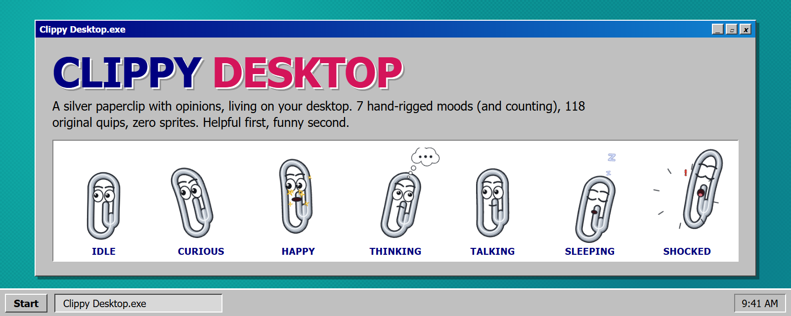
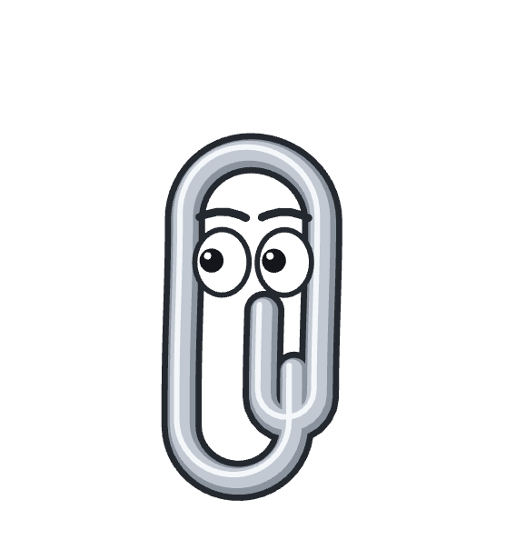
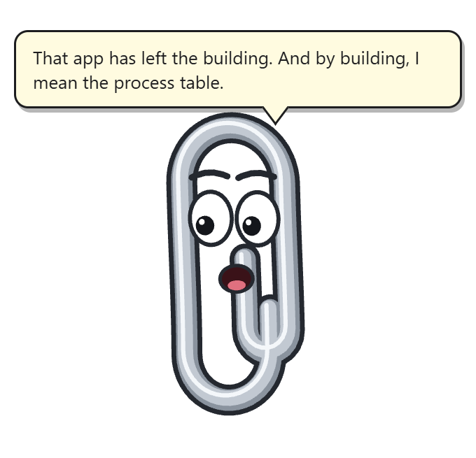
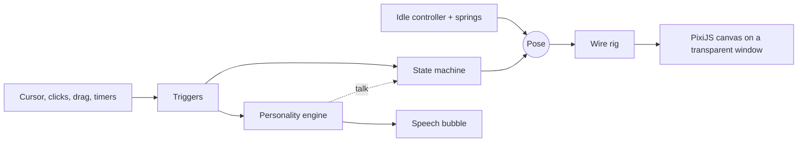

<p align="center">
  
</p>

<p align="center">
  
  
  
  
  
  
</p>

<h3 align="center">A silver paperclip with opinions, living on your desktop.<br>Helpful first, funny second.</h3>

Clippy Desktop is a transparent, always-on-top desktop companion. He floats above your windows, follows your cursor with his eyes, reacts when you poke him, gets sleepy when you leave, and has **118 original things to say** about it.

He is not a GIF. The whole character is a single wire **drawn and bent live every frame**: head lean that flexes the clip, squash and stretch on every hop, eyes that ride the curve. No sprite sheets, no frame-by-frame art, so he looks identical in every mood and stays razor sharp at any size.

## Meet the cast

|  |  |  |  |  |  |  |
| :---: | :---: | :---: | :---: | :---: | :---: | :---: |
| **Idle** | **Curious** | **Happy** | **Thinking** | **Talking** | **Sleeping** | **Shocked** |
| <sub>Breathes, floats, blinks, and watches your cursor across the whole desktop.</sub> | <sub>Hover over him. He tilts toward you, brows up, and tiptoes.</sub> | <sub>Click him. Three hops, sparkle eyes, a grin, confetti-ish sparkles.</sub> | <sub>Gaze up, brow cocked, thought cloud overhead.</sub> | <sub>Mouth flaps to the rhythm of whatever he says.</sub> | <sub>Two minutes of no cursor movement and he nods off, snoring Zs.</sub> | <sub>Click him three times fast, or wake him up. Jump, "!", pinprick pupils.</sub> |

## He talks

<p align="center"></p>

> *"Ah, another opportunity to introduce 47 new bugs."*
>
> *"WE DID IT. Mostly you. But emotionally, me."*
>
> *"Fine. I'll just sit here. Digitally unemployed."*

Quips are triggered by what you do (click, hover, drag, go idle, quit), never repeat until he has run out of lines, and back off when ignored. Turn the volume with **tray > Chattiness**: Quiet, Low, Normal, or Chatty.

## Features

- **Lives on your desktop**: transparent, borderless, click-through everywhere except Clippy and his speech bubble
- **Drag him anywhere**: he leans into the motion, wobbles, and lands with a squash. He remembers where you left him
- **Eyes that follow your cursor** across all your monitors, with blinks, double-blinks, and wandering glances
- **A real animation state machine**: priorities, interruption, cooldowns, cross-fades, and redirects (poke a sleeping Clippy and he startles awake instead of politely changing pose)
- **Resizable**: tray > Size (Small / Medium / Large)
- **Frugal**: 60 fps while moving, 30 fps when settled
- **Auto-updates** from GitHub Releases

## Run him

```bash
git clone https://github.com/ttzac/clippy-desktop
cd clippy-desktop
npm install
npm start
```

Right-click his tray icon for **Say something**, **Play animation**, **Size**, **Chattiness**, and **Quit** (he has a goodbye line).

Want an installer? `npm run dist` builds `dist/Clippy Desktop Setup x.y.z.exe`.

## How it works



Every frame the idle controller produces a base pose, the state machine layers whatever Clippy is currently feeling on top (cross-faded), and the rig bends the paperclip to match. Adding a mood is code and timing, not new art.

### Code map

```
src/main.js             Electron main: transparent window, click-through, drag, tray, position memory, updater
src/preload.js          contextBridge API (window.clippy)
src/renderer/
  character/            clippyShape (master silhouette), ClippyRig (deformable wire + eyes), pose (the Pose contract)
  animation/            Spring, Controller (idle + drag/landing -> base Pose), StateMachine (pure, tested),
                        states/ (interaction, ai, ambient), ease helpers
  effects/PixiFx.ts     pooled particles (sparkles, Zs, "!", shock lines) + thought-bubble prop
  personality/          Personality (pure, tested: cooldowns, repetition, spacing, backoff, levels), lines (dialogue by trigger)
  ui/bubble.ts          speech bubble
  main.ts               boot, render loop, input, updater wiring
```

**Design decision: procedural vector rig, not sprite frames.** Clippy is a single polyline sampled from the master silhouette and
deformed every frame (head lean that flexes the wire, travelling ripple, squash/stretch about the base, eye/brow rig).
Each frame the `Controller` makes the base idle pose, the `StateMachine` layers active states over it (cross-faded by weight), and the rig draws the result. States only produce a `PoseMod`; the rig only consumes a `Pose`. This keeps the character perfectly consistent across states,
is resolution independent, and means new states are code + timing, not new art. A new character or pack would supply its own
rig + controller against the same `Pose` contract.

**Performance:** the ticker runs at 60 fps while anything is moving (drag, blink, hover, spring energy) and drops to 30 fps when
settled. The main process polls the cursor at 20 Hz and only sends changes. Not yet measured with a profiler (see status).

## Dev tools

```bash
npm test            # state machine + personality engine
npm run typecheck
```

`CLIPPY_SMOKE_DIR=<dir> CLIPPY_SMOKE_STATES="happy@430,sleeping@5200" npx electron .` plays each state, captures a PNG after N ms, and exits. `npx electron scripts/make-hero.js <dir>` rebuilds the banner and state images in `docs/` from those captures.

<details>
<summary><b>Roadmap and honest status</b></summary>


| Area | State |
|---|---|
| Transparent frameless always-on-top window | Done |
| Click-through outside character/bubble | Done (bounding-box hit test, not pixel-accurate) |
| Drag with lean/stretch, bouncy landing, remembered position | Done |
| Cursor-following eyes (global cursor), blinks, saccades, breathing, float | Done |
| Tray icon + show/hide/update/quit | Done |
| Auto-update via GitHub Releases + release workflow | Done, untested end to end |
| Idle animation | Done (first pass; art direction still to polish) |
| State machine: priorities, interruption, cooldowns, min/extend duration, redirect (sleeping -> shocked), cross-fade | Done, 9 unit tests |
| States: curious, happy, thinking, talking, sleeping, shocked, dragging | Done, captured and reviewed in Electron; not yet judged in motion by a human at 60 fps |
| Triggers: hover -> curious, click -> happy, 3 fast clicks -> shocked, 2 min of no cursor movement -> sleeping (wakes on cursor movement), bubble text -> talking | Done |
| Particles: sparkles, Zs, "!", shock lines, thought cloud | Done |
| Thinking "scratches head" (needs an arm/hand), typing keyboard, waking stretch | Not done: thinking is gaze + sway + thought cloud only |
| Remaining states: laughing, typing, waking, angry, confused, sad, dancing, falling, landing (partly in Controller), hiding, peeking, celebrating, listening, error, victory | **Not started** |
| Steam, confetti, sparks, question marks, sunglasses accessory | Not started |
| Personality engine: 118 original lines in 23 trigger categories, per-category cooldowns, shuffle-bag + least-recently-said repetition prevention, global spacing, backoff when ignored, 4 chattiness levels persisted from the tray menu, time-of-day greetings, goodbye on quit | Done, 17 unit tests |
| Personality triggers wired: startup, click, click-spam, hover, drag, drop, startled-awake, idle, sleep, wake, ambient, long session, update available/ready/up-to-date, quit, tray "Say something" | Done |
| Personality lines written but not yet triggered: code editor opened, app crash, task complete (need permission-based desktop awareness), AI thinking/simple/error (Phase 6) | Pending |
| AI chat, streaming, provider layer, voice, approvals | Not started |
| Size setting (tray > Size: Small 60% / Medium 75% default / Large 100%, scales the whole window via page zoom) and quiet mode (Chattiness > Quiet) | Done |
| Fullscreen-app detection, multi-monitor testing, start with Windows | Not started |
| Asset validation script, audio | N/A yet (no raster assets; the character is procedural) |
| Resource measurements (CPU/GPU/RAM) | Not measured |
| Tauri migration | Deliberately not done: the Electron shell and update pipeline already work |

</details>

## Release (auto-update)

1. Bump `version` in `package.json`.
2. `git tag v0.1.1 && git push --follow-tags`.
3. The `Release` workflow builds the Windows installer and publishes it plus `latest.yml`. Installed apps check on launch and every 4 hours, download in the background, and install on quit (or via "Restart to update").

### Updates and tokens

The repo is public, so installed apps fetch releases with no token. If you fork this and make your fork private, add `"private": true` back to the `publish` block in `package.json` and give each machine a read-only token (env var `GH_TOKEN`, or `%APPDATA%Clippy Desktopconfig.json`: `{ "updateToken": "..." }`).

Installers are unsigned, so Windows SmartScreen warns on first install.

## Personality

Chattiness (tray menu > Chattiness, saved in `settings.json`): **Quiet** speaks only when it must (update-ready, "Say something"); **Low**, **Normal** and **Chatty** scale how often reactions fire and how far apart spontaneous remarks are (180s / 75s / 30s minimum, growing up to 4x while the user ignores them, reset on any interaction). Add dialogue in `src/renderer/personality/lines.ts`; every category needs a config entry (a test enforces this, plus 100+ unique lines under 120 characters).
